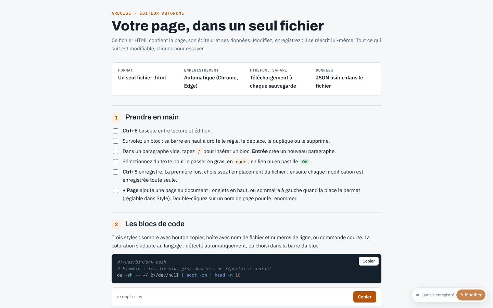

# Ardoise

**Un éditeur de pages WYSIWYG qui tient dans un seul fichier HTML.** La page, son éditeur et ses données voyagent ensemble : ouvrez `ardoise.html` dans un navigateur, modifiez, enregistrez — le fichier se réécrit lui-même. Rien à installer, aucun compte, aucun serveur.

> Ardoise est inspirée de [**Bento**](https://github.com/nyblnet/bento) (nyblnet), « la suite bureautique qui tient dans un fichier » : même idée d'un document HTML autonome qui embarque son propre éditeur et s'enregistre lui-même, et même organisation du dépôt — des sources lisibles, assemblées en un fichier unique au moment de la release. Ardoise ne contient pas de code de Bento.



## Télécharger et utiliser

1. Récupérez `ardoise.html` dans la [dernière release](../../releases/latest).
2. Ouvrez-le dans **Chrome ou Edge** : `Ctrl+S` une première fois pour choisir l'emplacement du fichier, ensuite chaque modification est enregistrée automatiquement.
   Sur Firefox et Safari, chaque enregistrement télécharge une copie à mettre à la place de l'ancienne.
3. `Ctrl+E` bascule entre lecture et édition. La visite guidée intégrée présente tous les blocs.

## Fonctions

- **Blocs** : en-tête, titres, paragraphes, étapes numérotées, fiche de faits, cartes, listes à cocher, tableaux, encadrés, blocs dépliables, images intégrées, séparateurs, pied de page.
- **Code** : trois styles (sombre, boîte avec nom de fichier et numéros de ligne, commande), coloration Bash, Python, PowerShell, JavaScript, JSON, YAML, SQL, HTML, C/Java/Go/Rust, détectée automatiquement.
- **Chronologies** verticales ou horizontales (titres inclinés), styles et libellés des liens, bulles de description.
- **Cartes géographiques** : fond simplifié intégré utilisable hors ligne, plan et satellite en ligne ; points, zones, cercles, itinéraires avec distances (km et milles nautiques), étiquettes déplaçables.
- **Plusieurs pages** par document, avec sommaire à gauche ou onglets selon la place disponible. Une page peut être rangée en **sous-page** de la précédente (menu ⋯ de la page) : groupes repliables dans le sommaire, seconde rangée d'onglets sur petit écran.
- **Liens entre pages** : `Ctrl+K` (ou « Lien » sur la sélection) propose une adresse web ou une autre page du document ; le lien suit la page si elle est renommée ou déplacée.
- **En-tête** : surtitre et chapeau s'affichent ou se masquent indépendamment (le texte masqué est conservé).
- **Protection par mot de passe** de l'édition, avec **chiffrement optionnel du contenu** (AES-256-GCM, clé dérivée du mot de passe par PBKDF2-SHA256, 600 000 itérations) : le fichier enregistré ne contient alors plus rien de lisible et le mot de passe est demandé à l'ouverture.
- **Export en page statique** (lecture seule, non chiffrée), **import / export JSON** (pour faire rédiger une page par une IA).
- **Mise à jour de l'éditeur** : chaque document embarque l'éditeur de la version qui l'a créé. *Fichier → Mettre à jour Ardoise* le remplace par la dernière version publiée (ou par un `ardoise.html` choisi sur le disque) en conservant le contenu, le mot de passe et le chiffrement.

## Plugin Obsidian

Le plugin **Ardoise pour Obsidian** ouvre les documents Ardoise du coffre dans un onglet d'Obsidian : lecture, édition, `Ctrl+S` et auto-save fonctionnent comme dans le navigateur, mais l'enregistrement va directement dans le fichier du coffre, sans boîte de dialogue.

- **Installation** : dans la [dernière release](../../releases/latest), récupérez `ardoise-obsidian.zip` et décompressez-le dans `<coffre>/.obsidian/plugins/ardoise/`, puis activez « Ardoise » dans *Paramètres → Plugins communautaires*.
- **Ouvrir** : un clic sur un fichier `.html` du coffre l'ouvre dans Ardoise (menu contextuel « Ouvrir dans Ardoise » et commande « Ouvrir le fichier courant dans Ardoise » si un autre plugin gère déjà les `.html`). Les autres fichiers HTML s'affichent en aperçu, en lecture seule.
- **Créer** : icône du ruban, commande « Ardoise : Nouveau document » ou « Nouveau document Ardoise » dans le menu d'un dossier.
- **Mettre à jour** : un document créé avec une version plus ancienne que le plugin affiche un bandeau « Mettre à jour » (sans réseau ni mot de passe : seul l'éditeur embarqué est remplacé).
- Le document s'exécute dans une iframe isolée (sans accès à Obsidian ni au coffre) et ne communique avec le plugin que pour enregistrer. Le plugin fonctionne aussi avec les documents créés par des versions antérieures d'Ardoise, qui embarquent leur propre éditeur.
- Dans Obsidian, les brouillons de secours du navigateur (`localStorage`) ne sont pas disponibles : l'auto-save, actif par défaut, écrit dans le coffre environ une seconde après chaque modification, et les modifications en attente sont enregistrées à la fermeture de l'onglet.

## Organisation du dépôt

```
src/
  index.html        gabarit du fichier final ({{…}} = contenus insérés à l'assemblage)
  css/page.css      styles de la page (repris aussi dans l'export statique)
  css/editor.css    styles de l'éditeur
  js/NN-*.js        code de l'application, concaténé dans l'ordre des numéros
  data/geo.json     fond de carte simplifié, villes et ports (généré, voir plus bas)
obsidian/           plugin Obsidian (main.js, manifest.json, styles.css)
build.mjs           assemble src/ en dist/ardoise.html et le plugin dans dist/obsidian/ (Node.js, sans dépendance)
scripts/check.mjs   vérifications du fichier assemblé
scripts/geo/        génération de src/data/geo.json depuis Natural Earth
.github/workflows/  CI et publication des releases
```

Le code JavaScript est un seul module découpé en fichiers par thème (rendu, saisie, cartes, pages, enregistrement…) : les fichiers partagent la même portée et sont simplement concaténés, sans outil de bundling.

## Assembler localement

```bash
node build.mjs          # → dist/ardoise.html et dist/obsidian/
node scripts/check.mjs  # vérifie la syntaxe et la structure du fichier produit
```

Node.js 18 ou plus récent, aucune dépendance à installer.

## Releases et tags (GitHub Actions)

Les releases ne se font pas à la main : le workflow [`release.yml`](.github/workflows/release.yml) s'en charge.

- À chaque push sur `main`, il assemble et vérifie `dist/ardoise.html`.
- Si la version indiquée dans `package.json` n'a pas encore de tag, il crée le tag `vX.Y.Z` et la release GitHub correspondante, avec `ardoise.html` et le plugin Obsidian (`ardoise-obsidian.zip`) en pièces jointes et des notes générées à partir des commits ; il publie aussi `ardoise.html` sur la branche `latest`, d'où les documents se mettent à jour (les pièces jointes des releases ne peuvent pas être téléchargées depuis une page web).
- Une fois la release publiée, il supprime les branches dont la pull request a été fusionnée dans `main` (sauf si elles ont reçu des commits depuis la fusion).
- Lancé à la main (*Actions → Release → Run workflow*) avec un tag, par exemple `v1.3.0`, il reconstruit ce tag et remplace les fichiers joints de sa release.
- Pour publier une nouvelle version : augmentez `version` dans `package.json` et poussez sur `main`.

Le workflow [`ci.yml`](.github/workflows/ci.yml) assemble et vérifie le fichier sur les pull requests et les autres branches, et le met à disposition comme artefact.

## Fond de carte

`src/data/geo.json` est produit par `scripts/geo/build_geo.py` à partir de [Natural Earth](https://www.naturalearthdata.com/) (domaine public) ; les instructions de récupération des données sont en tête du script. Les fonds « Plan » et « Satellite », chargés en ligne, viennent d'Esri (ou de CARTO avec une clé personnelle). Les polices Archivo et IBM Plex sont chargées depuis Google Fonts ; hors ligne, Ardoise utilise les polices du système.

## Licence

Ardoise est dans le domaine public ([Unlicense](LICENSE)) : utilisez, copiez, modifiez et redistribuez-la librement, sans obligation de mention.
