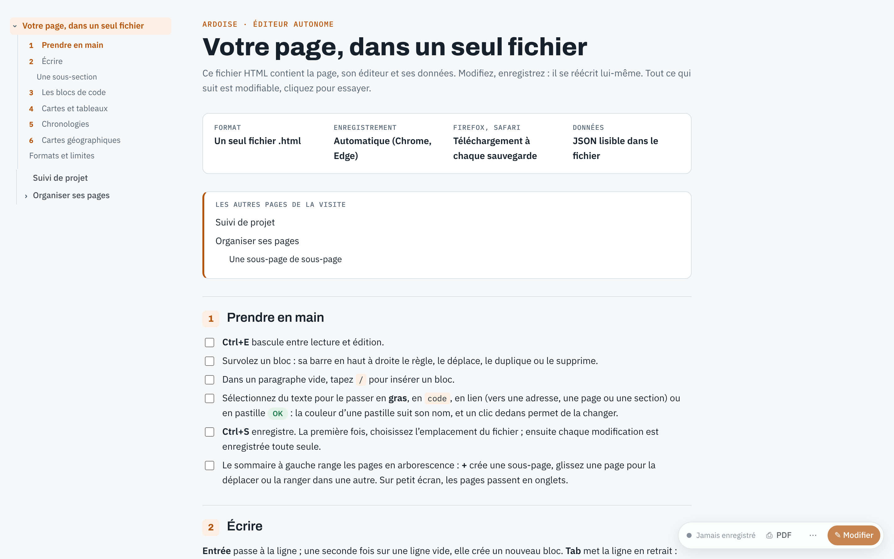

#  Ardoise

**Un éditeur de pages WYSIWYG qui tient dans un seul fichier HTML.** La page, son éditeur et ses données voyagent ensemble : ouvrez `ardoise.html` dans un navigateur, modifiez, enregistrez — le fichier se réécrit lui-même. Rien à installer, aucun compte, aucun serveur.

> Ardoise est inspirée de [**Bento**](https://github.com/nyblnet/bento) (nyblnet), « la suite bureautique qui tient dans un fichier » : même idée d'un document HTML autonome qui embarque son propre éditeur et s'enregistre lui-même, et même organisation du dépôt — des sources lisibles, assemblées en un fichier unique au moment de la release. Ardoise ne contient pas de code de Bento.



## Télécharger et utiliser

1. Récupérez `ardoise.html` dans la [dernière release](../../releases/latest).
2. Ouvrez-le dans **Chrome ou Edge** : `Ctrl+S` une première fois pour choisir l'emplacement du fichier, ensuite chaque modification est enregistrée automatiquement.
   Sur Firefox et Safari, chaque enregistrement télécharge une copie à mettre à la place de l'ancienne.
3. `Ctrl+E` bascule entre lecture et édition. La visite guidée intégrée présente tous les blocs.

## Fonctions

- **Blocs** : en-tête, titres de section et sous-sections (repris dans le sommaire), sous-titres (hors sommaire), paragraphes (`Entrée` passe à la ligne, une seconde fois sur une ligne vide crée un nouveau bloc ; `Tab` met la ligne en retrait, `Maj+Tab` ou `Retour arrière` en début de ligne en retirent un niveau, la ligne suivante garde ce retrait, et une ligne longue reste alignée sur son retrait), étapes numérotées, fiche de faits, cartes, listes à cocher, tableaux, encadrés, blocs dépliables, images intégrées (depuis un fichier, le presse-papiers ou une adresse web, toujours stockées dans le document), séparateurs, pied de page.
- **Code** : trois styles (sombre, boîte avec nom de fichier et numéros de ligne, commande), coloration Bash, Python, PowerShell, JavaScript, JSON, YAML, SQL, HTML, C/Java/Go/Rust, détectée automatiquement.
- **Chronologies** verticales ou horizontales (titres inclinés), styles et libellés des liens, bulles de description.
- **Cartes géographiques** : fond simplifié intégré utilisable hors ligne, plan et satellite en ligne ; points, zones, cercles, itinéraires avec distances (km et milles nautiques), étiquettes déplaçables ; noms des pays et des villes du fond simplifié masquables. **Données par pays** (carte choroplèthe) : pays colorés selon une valeur, échelle linéaire, logarithmique, en quantiles ou en intervalles égaux, palettes prêtes à l'emploi (dont divergentes, avec un centre réglable) ou personnalisées, légende, valeurs ou noms affichés sur les pays et déplaçables, infobulle au survol ; étiquettes répétées sur les territoires détachés (Guyane, Réunion, Canaries, Alaska…) et territoires rattachés (Nouvelle-Calédonie, Groenland…) colorés comme leur pays, au choix ; saisie pays par pays (un clic sur la carte retrouve le pays), collage de deux colonnes d'un tableur (noms français ou anglais, codes ISO), ou lecture des valeurs dans un **bloc tableau** du document, tenue à jour pendant la saisie. Un itinéraire s'importe en collant une liste de points (« lat, lon », libellé après une tabulation).
- **Plusieurs pages** par document, rangées en **arborescence** sur autant de niveaux que nécessaire : sommaire à gauche façon explorateur (chevrons, pages repliables, « + » pour une sous-page, menu ⋯), ou onglets sur petit écran. Une page se déplace par **glisser-déposer** dans le sommaire (avant, après, ou dans une autre page) ou par son menu ; ses sous-pages la suivent. **Précédent et Suivant** du navigateur (et le geste retour d'Android) ramènent à la page ou à la section vue avant, à la même position ; l'adresse (`#pg-…`) rouvre la page affichée, dans l'éditeur comme dans l'export. « Déplacer vers la page… », dans le menu d'un bloc, le range dans une autre page (une section part avec son contenu), et les liens vers lui le suivent.
- **Listes à sous-niveaux** (listes à puces, numérotées et à cocher) : `Tab` / `Maj+Tab`. Une liste à cocher peut afficher les cases cochées en premier ou à la fin (l'ordre saisi est conservé, la liste se réordonne quand on coche).
- **Sur téléphone** (écran étroit) : la barre ne garde que le nom du document, l'état de la synchronisation et de l'enregistrement, et un menu ☰ qui s'ouvre en plein écran avec toutes les actions en grands boutons.
- **Barre de lecture** (en bas à droite) : imprimer ou enregistrer en PDF (A4 avec marges, thème clair, titres jamais seuls en bas de page, et cartes, kanbans, fiches, encadrés, code ou images jamais coupés entre deux pages ; un long paragraphe ou un grand tableau peut l'être, avec l'en-tête du tableau répété), exporter en page statique ou en Word (.docx), tout plier / tout déplier, thème clair ou sombre pour soi (sans modifier le document), raccourcis.
- **Annuler et rétablir** (`Ctrl+Z`, `Ctrl+Y`) : les boutons ↶ et ↷ disent ce que l'étape annule ou rétablit (« Accueil · Paragraphe « … » : texte modifié »). Le menu d'un bloc plus haut que l'écran reste visible en haut pendant le défilement.
- **Pastilles nommées** : la couleur d'une pastille suit son nom (même nom, même couleur partout), choisie automatiquement parmi 16 couleurs à sa création. Un clic dans une pastille permet de changer la couleur de son nom partout, ou de cette pastille seulement. Taper `#` suivi de lettres propose les pastilles du document (recherche sans accents ni casse, « Créer » pour une nouvelle) ; *Style → Pastilles du document* liste leurs usages, change leur couleur et retire celles qui ne servent plus. Copiée hors d'Ardoise, une pastille devient le texte `#nom`.
- **Liens** : « Lien » (`Ctrl+K`) vers une adresse web, « Page » vers une page ou une section du document (avec recherche) ; le lien suit la page ou la section si elle est renommée ou déplacée. Le curseur dans un lien affiche une bulle pour l'ouvrir, le modifier ou le retirer. Liens possibles aussi dans le surtitre et le chapeau.
- **Sections pliables** (titres de section, étapes, sous-sections). En édition, l'état plié est enregistré et sert d'état de départ ; en lecture (et dans l'export statique), chacun plie et déplie librement, sans modifier le document. Déplacer un titre plié emmène sa section.
- **Groupe repliable** : un bloc à titre cliquable qui contient d'autres blocs (un seul niveau, sans titre de section), pour replier quelques blocs sans replier toute la section. On y range des blocs par glisser-déposer, par Monter / Descendre (qui en sortent au bord) ou par le menu ⋯ (« Mettre dans un groupe », « Sortir du groupe », « Dégrouper ») ; plié comme une section, ouvert à l'impression.
- **Tableaux** : flèches pour passer d'une cellule à l'autre, `Entrée` ou `Tab` à la fin de la dernière cellule ajoutent une ligne ; lignes et colonnes se déplacent par glisser-déposer (poignées au survol). Clic droit (ou appui long) dans une cellule : insérer ou supprimer une ligne ou une colonne. La loupe filtre les lignes (sans casse ni accents, pastilles comprises), aussi dans la vue tableau d'une requête. Une plage copiée d'Excel, de LibreOffice Calc ou de Google Sheets se colle dans les cellules et agrandit le tableau (ailleurs, elle crée un tableau) ; une plage de cellules sélectionnée (`Maj`+clic, glisser, `Maj`+flèches) se copie vers un tableur, et `Suppr` la vide.
- **Bloc kanban** : colonnes de cartes (titre, description, et si besoin échéance, responsable et priorité P1 à P3, affichés seulement s'ils sont remplis ; échéance dépassée en rouge, cadre rouge, orange ou bleu selon la priorité). Les cartes se déplacent par glisser-déposer ou par « Déplacer vers… », en édition comme en lecture. Une carte peut dépendre d'autres cartes (« Dépend de… », affichées « Attend » et « Bloque ») ; l'échéance se saisit en jj/mm/aaaa avec un calendrier ; une colonne se réduit en bande verticale (nom et nombre de cartes).
- **Modèle diamant** (analyse d'intrusion) : un losange avec l'adversaire en haut, l'infrastructure à gauche, la capacité à droite et la victime en bas, reliés par ses côtés et ses deux axes en pointillés ; chaque sommet est un texte enrichi avec pastilles, sous un titre facultatif. Sur un écran étroit, les sommets s'empilent.
- **Bloc requête** (sans syntaxe à apprendre) : les fiches de faits, lignes de tableaux, cartes de kanban (avec leur colonne), modèles diamant ou cases à cocher (toutes, cochées ou non cochées) de tout le document, d'une page (avec ou sans ses sous-pages) ou d'une section, filtrées par pastilles (seules celles présentes dans la portée choisie sont proposées) et, pour les cartes de kanban, par responsable, par priorité et par échéance (dépassée, aujourd'hui, dans les N jours, semaines ou mois, au-delà…), affichées en tableau, en liste ou en colonnes façon kanban (tri par colonne, par élément, par état ou par source, en reconnaissant nombres et dates ; nombre de résultats limitable ; un clic sur un en-tête trie aussi) ou en **cartes de nombre** : autant de cartes que voulu, à la suite, chacune avec son texte, ses pastilles, et un total au choix (aucun, tous les résultats, ou un autre filtre) pour afficher « X / total » avec une barre de progression, et un lien vers la page ou la section visée. Les cases à cocher se cochent depuis la requête, et une sous-case affiche le texte de sa case parente (ou le titre de sa carte). Tenu à jour, avec un lien vers la source de chaque résultat.
- **Bloc sommaire** : sections de la page (avec ou sans sous-sections) ou sous-pages (nombre de niveaux au choix), dans l'ordre de la page ou par ordre alphabétique, tenu à jour automatiquement.
- **En-tête** : surtitre et chapeau s'affichent ou se masquent indépendamment (le texte masqué est conservé).
- **Synchronisation entre copies**, en direct et hors ligne (*Fichier → Synchronisation*) : toute copie du fichier reste à jour avec les autres ; deux personnes qui écrivent dans le même paragraphe voient leurs saisies fusionnées, caractère par caractère, et une copie restée hors ligne se rattrape à sa prochaine ouverture. On voit qui est là (nom généré, modifiable) et quel bloc chacun modifie. Les échanges passent par un **relais aveugle** qui ne voit que des données chiffrées (AES-256-GCM, clé rangée dans le fichier) ; le relais s'installe chez soi en une commande (voir [relais/](relais/)).
- **Protection par mot de passe** de l'édition, avec **chiffrement optionnel du contenu** (AES-256-GCM, clé dérivée du mot de passe par PBKDF2-SHA256, 600 000 itérations) : le fichier enregistré ne contient alors plus rien de lisible et le mot de passe est demandé à l'ouverture.
- **Export en page statique** (lecture seule, non chiffrée), **Copier pour Office** (menu ⋯ d'un bloc : le bloc se colle mis en forme dans Word, PowerPoint, LibreOffice ou Google Docs ; carte ou chronologie en image), **export Word (.docx)** de la page ou d'un bloc (menu ⋯ du bloc ; titres en styles Word, listes, tableaux, pastilles surlignées, images, cartes et chronologies en images ; non chiffré), **import / export JSON** (pour faire rédiger une page par une IA), **import Markdown** dans la page courante (une note d'Obsidian : titres, listes, tâches, tableaux, code, encadrés, propriétés YAML en fiche de faits, `#tag` en pastilles, liens `[[…]]`, images).
- **Mise à jour de l'éditeur** : chaque document embarque l'éditeur de la version qui l'a créé. *Fichier → Mettre à jour Ardoise* le remplace par la dernière version publiée (ou par un `ardoise.html` choisi sur le disque) en conservant le contenu, le mot de passe et le chiffrement.

## Mettre à jour un document

Chaque document embarque **son propre éditeur**, celui de la version d'Ardoise qui l'a créé. Quand une nouvelle version sort, vos documents existants ne changent pas tout seuls : on les met à jour un par un, en gardant tout leur contenu.

**Dans le navigateur**

1. Ouvrez le document et passez en édition (`Ctrl+E`).
2. *Fichier → Mettre à jour Ardoise…* : Ardoise cherche la dernière version publiée. Hors ligne, *Choisir un fichier…* et prenez un `ardoise.html` téléchargé depuis les [releases](../../releases/latest).
3. *Mettre à jour* : le fichier est réécrit avec le nouvel éditeur, le même contenu, le même mot de passe et le même chiffrement, puis il se recharge. Sur Firefox et Safari, une copie est téléchargée : mettez-la à la place de l'ancien fichier.

**Dans Obsidian** : après la mise à jour du plugin, un document plus ancien affiche un bandeau *Mettre à jour vers …* ; un clic suffit (sans réseau ni mot de passe).

**Et le contenu ?** Rien à faire. Quand une version change la façon dont le contenu est rangé dans le fichier (son *format*), le nouvel éditeur convertit le document tout seul à l'ouverture, et le fichier est réécrit dans le nouveau format au prochain enregistrement.

**Un document plus récent que son éditeur** (par exemple enregistré en 1.6 puis rouvert avec une copie 1.5) s'affiche en lecture seule avec un bandeau *Mettre à jour…*, pour que rien ne soit perdu. Les éditeurs antérieurs à 1.5 n'ont pas cette protection : mettez à jour tous vos documents plutôt que de garder d'anciennes copies d'Ardoise.

## Synchroniser plusieurs copies

1. Installez un relais (une commande, voir [relais/README.md](relais/README.md)), ou utilisez celui de quelqu'un en qui vous avez confiance : il ne voit de toute façon que des données chiffrées.
2. Dans le document : *Fichier → Synchronisation…*, saisissez l'adresse du relais (`wss://…`), puis *Activer*.
3. Enregistrez le fichier, puis partagez-en une copie (courriel, clé USB, dossier partagé…). **Toute copie du fichier se synchronise** : la clé est dans le fichier, chiffrée avec lui si le document est protégé par mot de passe.

Chacun voit les autres personnes présentes (pastilles en haut à droite, nom modifiable dans la même fenêtre) et, en édition, le bloc que chacun est en train de modifier. Les modifications arrivent en une seconde environ ; une copie hors ligne garde les siennes et se met à jour à sa prochaine ouverture. *Nouvelle clé* coupe les copies existantes.

**Mettre à jour Ardoise dans des copies synchronisées** : chaque copie embarque son propre éditeur, la synchronisation ne transporte que le contenu. Mettez donc à jour chaque copie (*Fichier → Mettre à jour Ardoise*) ; l'état de synchronisation est conservé et la copie reprend là où elle en était. Des copies de versions différentes continuent de se synchroniser tant que le format du document est le même ; si une copie à jour envoie un contenu d'un format plus récent, une copie plus ancienne met sa synchronisation en pause, sans rien perdre de ses propres modifications, et demande à être mise à jour. La fenêtre *Synchronisation* indique la version d'Ardoise des autres personnes quand elle diffère de la vôtre.

Bon à savoir : Annuler (`Ctrl+Z`) ne défait que vos propres modifications, en gardant celles reçues entre-temps ; si deux personnes changent le même réglage (couleur, case à cocher…), la dernière modification l'emporte ; un bloc déplacé pendant que quelqu'un le modifie peut perdre cette modification.

## Plugin Obsidian

Le plugin **Ardoise pour Obsidian** ouvre les documents Ardoise du coffre dans un onglet d'Obsidian : lecture, édition, `Ctrl+S` et auto-save fonctionnent comme dans le navigateur, mais l'enregistrement va directement dans le fichier du coffre, sans boîte de dialogue.

- **Installation** : dans la [dernière release](../../releases/latest), récupérez `ardoise-obsidian.zip` et décompressez-le dans `<coffre>/.obsidian/plugins/ardoise/`, puis activez « Ardoise » dans *Paramètres → Plugins communautaires*.
- **Ouvrir** : un clic sur un fichier `.html` du coffre l'ouvre dans Ardoise (menu contextuel « Ouvrir dans Ardoise » et commande « Ouvrir le fichier courant dans Ardoise » si un autre plugin gère déjà les `.html`). Les autres fichiers HTML s'affichent en aperçu, en lecture seule.
- **Créer** : icône du ruban, commande « Ardoise : Nouveau document » ou « Nouveau document Ardoise » dans le menu d'un dossier.
- **Mettre à jour** : un document créé avec une version plus ancienne que le plugin affiche un bandeau « Mettre à jour » (sans réseau ni mot de passe : seul l'éditeur embarqué est remplacé).
- Le document s'exécute dans une iframe isolée (sans accès à Obsidian ni au coffre) et ne communique avec le plugin que pour enregistrer. Le plugin fonctionne aussi avec les documents créés par des versions antérieures d'Ardoise, qui embarquent leur propre éditeur.
- Dans Obsidian, les brouillons de secours du navigateur (`localStorage`) ne sont pas disponibles : l'auto-save, actif par défaut, écrit dans le coffre environ une seconde après chaque modification, et les modifications en attente sont enregistrées à la fermeture de l'onglet.

## Organisation du dépôt

```
src/
  index.html        gabarit du fichier final ({{…}} = contenus insérés à l'assemblage)
  css/page.css      styles de la page (repris aussi dans l'export statique)
  css/editor.css    styles de l'éditeur
  assets/ardoise.svg  icône d'Ardoise (favicon du fichier et logo de la barre, teinté selon la couleur d'accent)
  js/NN-*.js        code de l'application, concaténé dans l'ordre des numéros
  data/geo.json     fond de carte simplifié, villes et ports (généré, voir plus bas)
obsidian/           plugin Obsidian (main.js, manifest.json, styles.css)
build.mjs           assemble src/ en dist/ardoise.html et le plugin dans dist/obsidian/ (Node.js, sans dépendance)
scripts/check.mjs   vérifications du fichier assemblé et des migrations du format
scripts/fixtures/   documents de référence des migrations (format-N.json → format-N.attendu.json)
                    et presse-papier/ : extraits de collage depuis les tableurs
scripts/capturer-presse-papier.sh  enregistre le vrai presse-papier (Wayland) en extraits de collage
scripts/geo/        génération de src/data/geo.json depuis Natural Earth
.github/workflows/  CI et publication des releases
```

Le code JavaScript est un seul module découpé en fichiers par thème (rendu, saisie, cartes, pages, enregistrement…) : les fichiers partagent la même portée et sont simplement concaténés, sans outil de bundling.

## Format du document et migrations (développement)

Le contenu est un JSON (balise `#ardoise-doc`) qui porte le numéro de son format (`v`). À l'ouverture, `src/js/05-migrations.js` amène un document ancien au format courant, étape par étape, sur une copie ; le fichier est réécrit au format courant au prochain enregistrement. Un document d'un format plus récent que l'éditeur s'ouvre en lecture seule, et la mise à jour de l'éditeur repart du fichier tel qu'il a été ouvert.

Pour faire évoluer le format :

1. incrémenter `VERSION` dans `src/js/00-entete.js` ;
2. ajouter l'étape `{ from: <ancien format>, desc, run }` dans `src/js/05-migrations.js` ;
3. ajouter un document de référence `scripts/fixtures/format-N.json` (N = ancien format) et le résultat attendu `format-N.attendu.json`, et mettre à jour les `.attendu.json` existants.

`scripts/check.mjs` (lancé par la CI) vérifie qu'il ne manque aucune étape et que chaque document de référence donne exactement le résultat attendu.

| Format | Ardoise | Changement |
| --- | --- | --- |
| 1 | jusqu'à 1.4 | — |
| 2 | 1.5 | Surtitre de l'en-tête en texte enrichi (liens) ; palette « ardoise » renommée « graphite » |
| 3 | 1.6 | Listes à sous-niveaux (éléments `{ html, lv }`) ; pastilles nommées (registre `tags`, exceptions `pc-N`) ; pages sur plusieurs niveaux (`lv` au lieu de `sub`) |
| 4 | 1.7 | Bloc « Requête » (nouveau type de bloc, sans conversion) |
| 5 | 1.10 | Bloc « Kanban » (nouveau type de bloc) ; retrait ligne par ligne des paragraphes (`span.tab`), sans conversion |
| 6 | 1.22 | Blocs « Groupe repliable » et « Modèle diamant » (nouveaux types de blocs), sans conversion |

## Assembler localement

```bash
node build.mjs          # → dist/ardoise.html et dist/obsidian/
node scripts/check.mjs  # vérifie la syntaxe et la structure du fichier produit
```

Node.js 18 ou plus récent, aucune dépendance à installer.

## Releases et tags (GitHub Actions)

Les releases ne se font pas à la main : le workflow [`release.yml`](.github/workflows/release.yml) s'en charge.

- À chaque push sur `main`, il assemble et vérifie `dist/ardoise.html`.
- Si la version indiquée dans `package.json` n'a pas encore de tag, il crée le tag `vX.Y.Z` et la release GitHub correspondante, avec `ardoise.html` et le plugin Obsidian (`ardoise-obsidian.zip`) en pièces jointes et des notes générées à partir des commits ; il publie aussi `ardoise.html` sur la branche `latest`, d'où les documents se mettent à jour (les pièces jointes des releases ne peuvent pas être téléchargées depuis une page web).
- Une fois la release publiée, il supprime les branches dont la pull request a été fusionnée dans `main` (sauf si elles ont reçu des commits depuis la fusion).
- Lancé à la main (*Actions → Release → Run workflow*) avec un tag, par exemple `v1.3.0`, il reconstruit ce tag et remplace les fichiers joints de sa release.
- Pour publier une nouvelle version : augmentez `version` dans `package.json` et poussez sur `main`.

Le workflow [`ci.yml`](.github/workflows/ci.yml) assemble et vérifie le fichier sur les pull requests et les autres branches, et le met à disposition comme artefact.

## Fond de carte

`src/data/geo.json` est produit par `scripts/geo/build_geo.py` à partir de [Natural Earth](https://www.naturalearthdata.com/) (domaine public) ; les instructions de récupération des données sont en tête du script. Les fonds « Plan » et « Satellite », chargés en ligne, viennent d'Esri (ou de CARTO avec une clé personnelle). Les polices Archivo et IBM Plex sont chargées depuis Google Fonts ; hors ligne, Ardoise utilise les polices du système.

## Licence

Ardoise est dans le domaine public ([Unlicense](LICENSE)) : utilisez, copiez, modifiez et redistribuez-la librement, sans obligation de mention.
